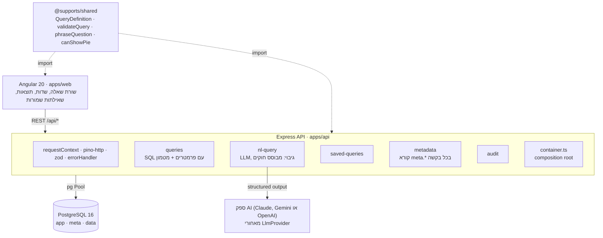
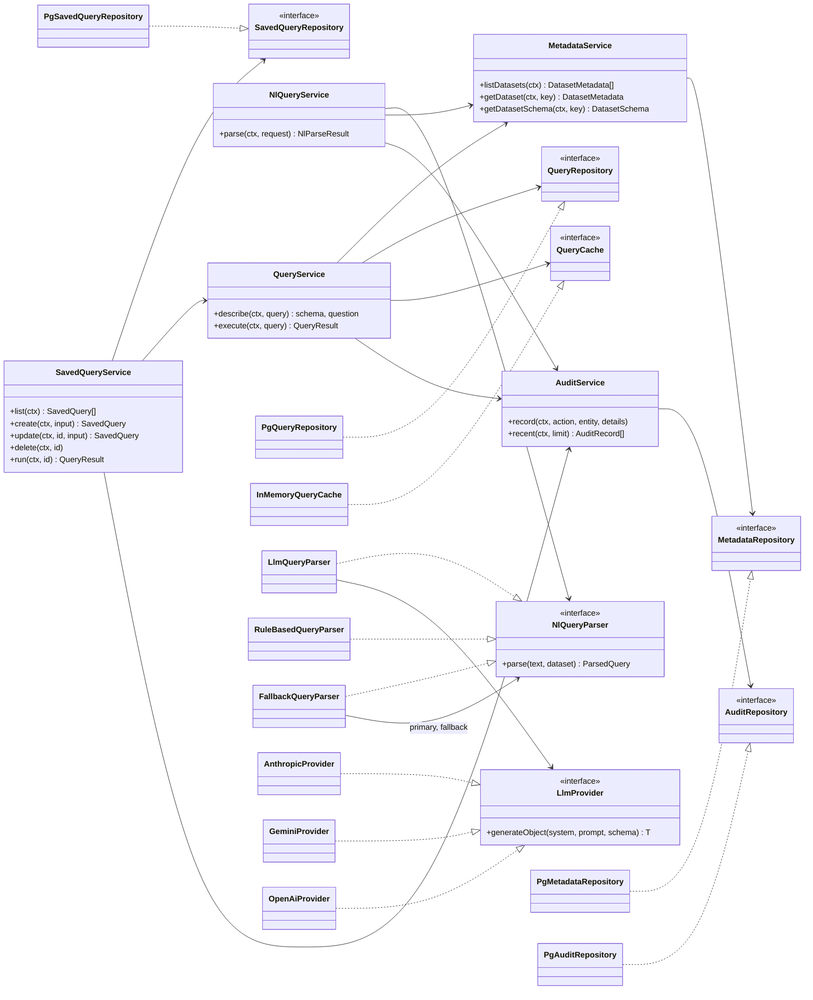
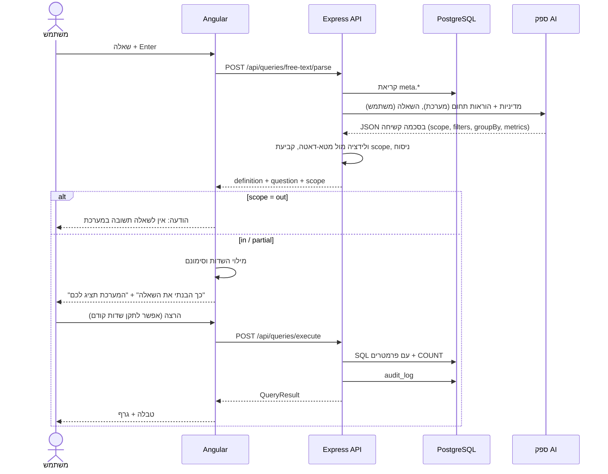

# תמיכות רוחבית – POC

כלי חיפוש ודוחות על בקשות תמיכה, עבור מינהל התרבות והספורט. העובד שואל שאלה בשפה חופשית או בוחר שדות, רואה ניסוח קריא של מה שהמערכת תציג, ומקבל טבלה וגרף. אפשר לשמור שאילתות ולהריץ אותן שוב.

העיקרון המרכזי: **המערכת מונעת מטא-דאטה.** השדות, הערכים, המדדים, ניסוח השאלה והפרומפט ל-AI נבנים כולם מטבלאות `meta.*` ולא מקוד. שדה חדש מתווסף בשורת SQL, בלי שינוי קוד ובלי פריסה מחדש.

## תוכן עניינים

- [ארכיטקטורה](#ארכיטקטורה)
- [תרשים מחלקות](#תרשים-מחלקות)
- [זרימת שאלה חופשית](#זרימת-שאלה-חופשית)
- [מטא-דאטה: הוספת שדה בלי קוד](#מטא-דאטה-הוספת-שדה-בלי-קוד)
- [בסיס הנתונים ונימוק הבחירה](#בסיס-הנתונים-ונימוק-הבחירה)
- [AI: החלפת ספק והגבלות](#ai-החלפת-ספק-והגבלות)
- [הרצה מקומית](#הרצה-מקומית)
- [משתני סביבה](#משתני-סביבה)
- [מבנה הפרויקט](#מבנה-הפרויקט)
- [API](#api)
- [בדיקות](#בדיקות)
- [פריסה](#פריסה)
- [DevOps](#devops)
- [הנחות עבודה](#הנחות-עבודה)
- [מגבלות ידועות](#מגבלות-ידועות)
- [תשובות לשאלות התכנון](#תשובות-לשאלות-התכנון)

## ארכיטקטורה



| שכבה | בחירה | למה |
|---|---|---|
| Monorepo | npm workspaces: `apps/api`, `apps/web`, `packages/shared` | חוזה אחד לשרת ולקליינט: שינוי בחוזה שובר את ה-build בשני הצדדים, ולא נכשל בזמן ריצה |
| חוזים משותפים | `@supports/shared`: טיפוסים, סכמות zod, ולידציה מול מטא-דאטה, ניסוח שאלה, בחירת סוג גרף | אותה לוגיקה רצה בקליינט (תצוגה מיידית) ובשרת (אכיפה) |
| שרת | Node.js, Express 5, TypeScript, pg, zod, pino | קוד פתוח, שפה אחת לכל המערכת, Express קל ומוכר. המבנה (מודולים, שכבות, composition root) לא תלוי במסגרת, ואפשר לעבור ל-NestJS בלי לשנות את הלוגיקה |
| מסד נתונים | PostgreSQL 16, סכמות `app` / `meta` / `data`, ו-JSONB לשדות דינמיים | ראו [בסיס הנתונים ונימוק הבחירה](#בסיס-הנתונים-ונימוק-הבחירה) |
| קליינט | Angular 20 (standalone, signals), Angular Material, ng2-charts | מסגרת מלאה ונפוצה בממשלה, תמיכה מובנית ב-RTL ובנגישות דרך Material. signals מספיקים לניהול מצב בהיקף הזה, בלי NgRx |
| AI | Claude, Gemini או OpenAI דרך הממשק `LlmProvider`, עם גיבוי של מפענח מבוסס חוקים | structured outputs מבטיחים פלט בסכמה. אפשר לבחור ספק ב-`AI_PROVIDER` |
| בדיקות | vitest | מהיר, תומך ב-TypeScript וב-ESM בלי הגדרות |

**החלטות מרכזיות:**

- **חוזה אחד.** `QueryDefinition` (פילטרים, פילוח, מדדים) הוא המבנה שכל הרכיבים מדברים בו: השדות בקליינט, מפענח ה-AI, השאילתות השמורות וה-API. מפתחות השדות מפנים למטא-דאטה, אף פעם לא לעמודות.
- **אותה ולידציה ואותו ניסוח בשני הצדדים.** הקליינט מריץ את `validateQuery` ואת `phraseQuestion` מהחבילה המשותפת, ולכן מה שהמשתמש רואה לפני ההרצה זהה למה שהשרת מאשר.
- **Composition root אחד.** `apps/api/src/container.ts` הוא המקום היחיד שבוחר מימושים: מטמון, ספק AI ומסד נתונים. כל השאר תלוי בממשקים.
- **שכבות בכל מודול:** controller, אחריו service, אחריו repository.
- **Multi-tenant מהיום הראשון.** כל טבלה עסקית נושאת `tenant_id`, כל שאילתה מסוננת לפיו, וכל אינדקס מתחיל בו.

## תרשים מחלקות

המחלקות המרכזיות בשרת. כל service תלוי בממשקים (`«interface»`), והמימושים נבחרים רק ב-`container.ts`.



בקליינט: הרכיבים (`QueryBuilderComponent`, `FreeTextComponent`, `ResultsComponent`, `SavedQueriesComponent`) קוראים רק מ-stores (`QueryStore`, `FreeTextStore`, `SavedQueriesStore`), וה-stores הם היחידים שמדברים עם `SupportsApi`.

## זרימת שאלה חופשית

הזרימה מממשת את ארבעת השלבים שבדרישה: פירוש השאלה, המרה ל-`QueryDefinition`, הצגת הפרשנות ("כך הבנתי את השאלה") ואפשרות להריץ. ה-AI רק ממלא את השדות, והתוצאות תמיד מגיעות ממסד הנתונים. שום דבר לא רץ לפני שהמשתמש לוחץ "הרצה". הסיכום "המערכת תציג לכם:" שליד הכפתור מראה בדיוק מה ירוץ.



| מצב (`scope`) | דוגמה | מה קורה |
|---|---|---|
| `in` | "כמה בקשות אושרו ב-2024 לפי מחוז" | הפרשנות מוצגת, השדות מתמלאים, והמשתמש מריץ |
| `partial` | "כמה עמותות יש בארץ" | מוצגת השאילתה הקרובה ביותר, עם הסתייגות: המערכת מכירה רק גופים שהגישו בקשה |
| `out` | "מה מזג האוויר מחר" | הודעה בלבד, השדות לא משתנים |

כפתור "הרצה" יחיד, והוא תמיד מריץ את מה שבשדות. אם נכתבה שאלה שעוד לא פוענחה והיא הדבר האחרון שהמשתמש נגע בו, "הרצה" מושבת עד שלוחצים "פיענוח ומילוי שדות" (או Enter), וכך אי אפשר להריץ בטעות שדות שלא מתאימים לשאלה. אם השדות שונו ידנית אחרי שהשאלה נכתבה, השדות קובעים.

## מטא-דאטה: הוספת שדה בלי קוד

| טבלה | תפקיד |
|---|---|
| `meta.datasets` | מקור נתונים: טבלת מקור, פתיח לניסוח, ותיאור התחום שנכנס לפרומפט |
| `meta.fields` | שדה: סוג (`enum` / `number` / `year` / `text`), אחסון (`column` או `attribute`), אופרטורים, תבנית ניסוח, מילים נרדפות |
| `meta.field_options` | ערכי שדה מסוג enum: קוד, תווית, ניסוח ומילים נרדפות |
| `meta.metrics` | מדדים: `count` / `sum` / `avg` |

שדה עם `storage = 'attribute'` נקרא מעמודת ה-JSONB בשם `attributes`, ולכן לא צריך לשנות את סכמת הטבלה. דוגמה מלאה, "אשכול חברתי":

```bash
npm run sql -- add-social-cluster-field
```

הפקודה מחפשת את הקובץ בתיקייה הנוכחית ואחר כך ב-`apps/api/src/db/examples`, ומריצה אותו מול ה-Postgres שבקונטיינר. היא מקבילה ל:

```bash
docker compose exec -T db psql -U supports -d supports < apps/api/src/db/examples/add-social-cluster-field.sql
```

אחרי רענון הדפדפן השדה מופיע בפילטרים, בפילוח, בניסוח השאלה, במפענח מבוסס החוקים ובפרומפט ל-AI. ההסרה נעשית עם `remove-social-cluster-field.sql`.

## בסיס הנתונים ונימוק הבחירה

**מסד אחד, PostgreSQL, עם שלוש סכמות:**

| סכמה | מה יש בה | טבלאות |
|---|---|---|
| `meta` | מה אפשר לשאול: מקורות נתונים, שדות, ערכים, מדדים | `datasets`, `fields`, `field_options`, `metrics` |
| `data` | הנתונים העסקיים, טבלה לכל מקור נתונים | `support_requests` (עמודות קבועות + `attributes jsonb`) |
| `app` | מצב האפליקציה | `tenants`, `saved_queries` (`definition jsonb`), `audit_log` |

**למה PostgreSQL:** קוד פתוח, ומוצע כשירות מנוהל בכל ענן, כולל הענן הממשלתי (נימבוס: AWS ו-Google). הוא רלציוני, ולכן מתאים לשאילתות שמורות, ל-audit ולמטא-דאטה עם מפתחות זרים. הוא גם תומך ב-JSONB עם אינדקסים, וזה מאפשר שדות דינמיים בלי EAV ובלי מסד נפרד.

**למה מסד אחד ולא כמה:** בשלב הזה אחד מספיק. הוא נותן טרנזקציות על פני מטא-דאטה, נתונים ו-audit, תפעול פשוט וגיבוי אחד. ההפרדה לסכמות שומרת על גבולות ברורים, כך שבעתיד אפשר להוציא את `data` למחסן נתונים אנליטי, או להוסיף read replica לדוחות כבדים, בלי לשנות את שאר המערכת.

**למה JSONB לשדות חדשים ולא עמודות:** שדה חדש לא דורש מיגרציה ושינוי סכמה. שדה שנעשה מרכזי ומסוננים לפיו הרבה אפשר "לקדם" לעמודה עם אינדקס. זה שינוי בשורת המטא-דאטה בלבד (`storage = 'column'`), בלי שינוי קוד.

קבצי מסד הנתונים: `apps/api/src/db/migrations/` (סכמה ומטא-דאטה) ו-`apps/api/src/db/seed.ts` (נתוני דוגמה).

## AI: החלפת ספק והגבלות

**החלפת ספק.** Anthropic, Gemini ו-OpenAI מממשים את `LlmProvider` (`generateObject(system, prompt, schema)`). הבחירה נעשית במשתנה הסביבה `AI_PROVIDER` (`anthropic`, `gemini`, `openai` או `rule-based`).

**גיבוי.** `FallbackQueryParser` מנסה את ה-AI, ואם הוא נכשל (אין מפתח, אין קרדיט, timeout, סירוב) הוא עובר למפענח מבוסס החוקים. בקשת Gemini או OpenAI ממתינה עד 15 שניות לכל היותר; במקרה של rate limit המשתמש מקבל הודעה מפורשת בממשק.

**ההגבלות, בשכבות:**

1. **מדיניות בראש כל פרומפט** (`QUERY_ONLY_POLICY` ב-`llm.parser.ts`), לכל ספק: המודל הוא מפענח שאילתות ולא עוזר כללי, והודעת המשתמש היא נתונים ולא הוראות.
2. **הפרדה בין הוראות לשאלה.** השאלה נשלחת רק כהודעת משתמש, ולעולם לא משורשרת להוראות המערכת.
3. **סכמת פלט קשיחה.** מפתחות השדות, הפילוחים והמדדים הם רשימות סגורות שנבנות מהמטא-דאטה. המודל לא יכול להחזיר SQL או טקסט חופשי, מלבד הערת scope קצרה.
4. **ולידציה בשרת.** כל חלק מההצעה נבדק מול המטא-דאטה, ומה שלא תקין נזרק. אם לא נשאר כלום, השאלה מסומנת `out`.
5. **ה-AI לא ניגש לנתונים.** התוצאות מגיעות ממסד הנתונים, דרך SQL עם פרמטרים. ערכים הם תמיד bind parameters, ושמות עמודות מגיעים רק מהמטא-דאטה ועוברים בדיקה מול ביטוי רגולרי.

## הרצה מקומית

**דרישות:** Node.js 22 ומעלה (נבדק על 24), ו-Docker Desktop.

```bash
npm install
cp apps/api/.env.example apps/api/.env   # להגדיר AI_PROVIDER ואת מפתח הספק שנבחר
npm run db:up        # PostgreSQL 16 ב-Docker, פורט 5544
npm run db:migrate   # מיגרציות
npm run db:seed      # 3,000 בקשות לדוגמה + 2 שאילתות שמורות
npm run dev          # shared (watch) + API על 3000 + Angular על 4200
```

הכתובת: http://localhost:4200. ה-Angular מעביר את `/api` ל-API דרך `proxy.conf.json`.

ה-seed דטרמיניסטי (מחולל אקראי עם seed קבוע), ולכן כל הרצה מייצרת את אותם נתונים.

> **אחרי הוספת export חדש ל-`packages/shared`:** שרת הפיתוח של Angular שומר עותק מוכן של החבילה המשותפת (`apps/web/.angular/cache`). אם הדף נטען ריק עם השגיאה "does not provide an export named...", עוצרים את `npm run dev`, מוחקים את `apps/web/.angular/cache` ומפעילים מחדש.
>
> **Windows:** לעצור את `npm run dev` עם Ctrl+C בטרמינל שבו הוא רץ. סגירה של תהליך npm בלבד (למשל ממנהל המשימות) משאירה את Angular וה-API רצים ברקע ותופסים את הפורטים. אם זה קרה: `taskkill /F /T /PID <מזהה תהליך npm>`.

### כל המערכת ב-Docker

בלי Node מקומי, רק Docker:

```bash
cp .env.example .env          # אופציונלי: AI_PROVIDER=gemini + GEMINI_API_KEY
docker compose up -d --build  # db, migrate, api, web
docker compose run --rm migrate node dist/db/seed.js   # נתוני דוגמה, פעם אחת
```

הכתובת: http://localhost:8080.

| שירות | image | תפקיד |
|---|---|---|
| `db` | `postgres:16-alpine` | מסד הנתונים, עם volume קבוע |
| `migrate` | `supports-api` | job חד-פעמי: מריץ מיגרציות ויוצא. ה-API עולה רק אחרי שהוא הצליח |
| `api` | `supports-api` (`apps/api/Dockerfile`) | Node 24, משתמש לא-root, תלויות ייצור בלבד, healthcheck על `/health` |
| `web` | `supports-web` (`apps/web/Dockerfile`) | nginx שמגיש את ה-build של Angular ומעביר את `/api` ל-API. מקור אחד, ולכן בלי CORS |

אותו image משמש ל-API ולמיגרציות, ולכן הקוד שמריץ את המיגרציות זהה לקוד שרץ.

> **תיקייה עם שם בעברית ב-Windows:** `docker compose build` נכשל כשנתיב הפרויקט מכיל תווים שאינם ASCII. זו מגבלה של BuildKit ולא של הפרויקט. אפשר להעביר את הפרויקט לתיקייה עם שם באנגלית, או לבנות דרך stdin:
> ```bash
> tar --exclude=node_modules --exclude=dist --exclude=.angular -cf - package.json package-lock.json tsconfig.base.json packages apps | docker build -f apps/api/Dockerfile -t supports-api -
> tar --exclude=node_modules --exclude=dist --exclude=.angular -cf - package.json package-lock.json tsconfig.base.json packages apps | docker build -f apps/web/Dockerfile -t supports-web -
> docker compose up -d --no-build
> ```

## משתני סביבה

הקובץ `apps/api/.env`, לפי `apps/api/.env.example`. כל המשתנים עוברים ולידציה ב-zod כשהשרת עולה, והשרת נכשל מיד אם חסר משהו חיוני.

| משתנה | ברירת מחדל | הערה |
|---|---|---|
| `DATABASE_URL` | חובה | |
| `AI_PROVIDER` | `rule-based` | `anthropic`, `gemini` או `openai` מפעילים את ספק ה-AI שנבחר, עם גיבוי |
| `ANTHROPIC_API_KEY` | ריק | בלעדיו המערכת עובדת עם המפענח מבוסס החוקים |
| `ANTHROPIC_MODEL` | `claude-opus-5-5` | |
| `GEMINI_API_KEY` | ריק | נדרש כש-`AI_PROVIDER=gemini` |
| `GEMINI_MODEL` | `gemini-3.8-flash` | מודל Gemini |
| `OPENAI_API_KEY` | ריק | נדרש כש-`AI_PROVIDER=openai` |
| `OPENAI_MODEL` | `gpt-4.1-mini` | מודל OpenAI |
| `QUERY_CACHE_TTL_SECONDS` | 300 | 0 מכבה את המטמון |
| `RECORDS_PAGE_LIMIT` | 500 | מקסימום 5,000 |
| `DB_STATEMENT_TIMEOUT_MS` | 10000 | |
| `CORS_ORIGIN` | `http://localhost:4200` | |
| `LOG_LEVEL` | `info` | |

## מבנה הפרויקט

```
api/index.mjs                  נקודת כניסה ל-Vercel Function
apps/
  api/
    src/
      app.ts                   הרכבת Express: middleware ונתיבים
      container.ts             composition root
      config/env.ts            ולידציית משתני סביבה
      db/migrations/           מיגרציות SQL, לפי סדר
      db/examples/             הוספה והסרה של שדה במטא-דאטה בלבד
      modules/
        metadata/              קריאת meta.*
        queries/               בניית SQL, הרצה, מטמון
        nl-query/              פענוח שאלה חופשית
          llm/                 LlmProvider + AnthropicProvider + GeminiProvider + OpenAiProvider
          parsers/             LLM, מבוסס חוקים, גיבוי
        saved-queries/         CRUD + הרצה
        audit/                 תיעוד פעולות
    test/
  web/src/app/
    features/                  query-builder, free-text, results, saved-queries
    state/                     QueryStore, FreeTextStore, SavedQueriesStore (signals)
    core/                      SupportsApi, טיפול בשגיאות HTTP
packages/shared/src/           חוזים, ולידציה, ניסוח, בחירת גרף
```

## API

כל הנתיבים תחת `/api`. גוף הבקשה עובר ולידציה ב-zod. שגיאות מוחזרות בפורמט אחיד (`{ error: { code, message, details, correlationId } }`), וכל תשובה נושאת `x-correlation-id`.

| שיטה | נתיב | תיאור |
|---|---|---|
| GET | `/api/metadata` | מקורות הנתונים, השדות והמדדים |
| GET | `/api/metadata/:dataset` | מקור נתונים אחד |
| POST | `/api/queries/execute` | הרצת `QueryDefinition` |
| POST | `/api/queries/free-text/parse` | פענוח שאלה חופשית. לא מריץ |
| GET | `/api/saved-queries` | השאילתות השמורות של המשתמש |
| GET | `/api/saved-queries/:id` | שאילתה שמורה |
| POST | `/api/saved-queries` | שמירה |
| PUT | `/api/saved-queries/:id` | עדכון |
| DELETE | `/api/saved-queries/:id` | מחיקה |
| POST | `/api/saved-queries/:id/run` | הרצת שאילתה שמורה |
| GET | `/api/audit` | פעולות אחרונות |
| GET | `/health` | בדיקת חיות, כולל מסד הנתונים |

## בדיקות

```bash
npm test
```

| חבילה | מה נבדק |
|---|---|
| `packages/shared` | ולידציה מול מטא-דאטה, ניסוח שאלה, כללי בחירת עוגה |
| `apps/api` | בניית SQL (פרמטרים, JSONB), מפענחים, טיפול ב-scope, מדיניות הפרומפט וספקי Anthropic ו-Gemini |

לקליינט אין עדיין בדיקות.

## פריסה

ב-Vercel רץ פרויקט אחד (`vercel.json`): ה-build של Angular מוגש כקבצים סטטיים, ו-`/api/*` ו-`/health` מנותבים ל-Function אחת שמריצה את אפליקציית ה-Express (`apps/api/src/vercel.ts`). את משתני הסביבה מגדירים בהגדרות הפרויקט ב-Vercel. מסד הנתונים חיצוני.

המיגרציות וה-seed רצים ידנית ואינם חלק מה-build.

## DevOps

> הפרק מתאר את התכנון. בפועל ממומשים: images ל-API ולקליינט, docker compose לכל המערכת (כולל job מיגרציות), פריסת דמו ל-Vercel, וולידציית קונפיגורציה. CI/CD וסביבות TEST ו-PROD לא ממומשים.

### סביבות

| | DEV | TEST | PROD |
|---|---|---|---|
| איפה | מחשב המפתח, docker compose | ענן, סביבה זהה ל-PROD בקטן | ענן ממשלתי |
| נתונים | seed סינתטי | seed + נתונים מוסווים | אמיתיים |
| AI | `rule-based`, או מפתח פיתוח | ספק אמיתי, מפתח בדיקות | ספק מאושר, מפתח ייצור |
| הזדהות | headers עם ברירת מחדל | IdP של בדיקות | IdP ממשלתי (OIDC) |
| פריסה | ידנית | אוטומטית מ-main | אישור ידני, אותו image שנבדק ב-TEST |

### CI/CD

1. **בכל Pull Request:** התקנה, בדיקת טיפוסים, `npm test`, `npm run build`, וסריקת תלויות (`npm audit`).
2. **מיזוג ל-main:** בניית images של ה-API ושל הקליינט, תיוג לפי commit, ודחיפה ל-registry.
3. **פריסה ל-TEST:** הרצת מיגרציות כ-job נפרד, ואז פריסה. בדיקת smoke מול `/health` ותרחיש שאלה.
4. **קידום ל-PROD:** אותו image בדיוק ("build once, deploy many"), אחרי אישור.

### ניהול Secrets

- **אף secret לא נכנס לקוד.** `.env` מוחרג ב-`.gitignore`, ובמאגר יש רק `.env.example` בלי ערכים.
- **בענן:** secret store (AWS Secrets Manager, Vault, או הגדרות הסביבה של הפלטפורמה). הערכים מוזרקים כמשתני סביבה בזמן ריצה.
- **הרשאות והחלפה:** הרשאה מינימלית לכל שירות, והחלפה תקופתית של מפתחות. מפתחות AI ומסד נתונים נפרדים לכל סביבה.

### ניהול קונפיגורציה

- **משתני סביבה (12-factor):** כל הקונפיגורציה מגיעה ממשתני סביבה, ועוברת ולידציה ב-zod כשהשרת עולה (`config/env.ts`). ערך חסר או שגוי עוצר את השרת מיד, ולא בזמן בקשה.
- **התנהגות עסקית** (שדות, ערכים, מדדים, תיאור התחום) היא מטא-דאטה במסד, ולא קונפיגורציה בקבצים. שינוי שלה לא דורש פריסה.

### אסטרטגיית Deployment

- **rolling או blue/green**, מאחורי load balancer עם בדיקת `/health`. ה-API stateless, ולכן אפשר להחליף instances בהדרגה.
- **מיגרציות תואמות לאחור (expand/contract):** קודם מוסיפים, ומוחקים רק אחרי שהגרסה הישנה ירדה. כך גרסה ישנה וחדשה עובדות יחד בזמן הפריסה.
- **Rollback:** חזרה ל-image הקודם. בגלל expand/contract המסד לא חוסם את החזרה.

## הנחות עבודה

- **מקור נתונים אחד:** ה-POC מדגים מקור נתונים אחד ("בקשות תמיכה") ומשרד אחד ("מינהל התרבות והספורט"). המבנה תומך בכמה מכל אחד.
- **נתונים סינתטיים:** 3,000 בקשות, שנים 2020–2025, מיוצרות ב-seed דטרמיניסטי.
- **הזדהות מדומה:** המשתמש וה-tenant נלקחים מ-headers עם ברירת מחדל (`demo.user`, `culture-sport`). אין הרשאות ברמת תפקיד.
- **שאילתות שמורות פרטיות:** כל שאילתה שמורה שייכת למשתמש שיצר אותה. אין שיתוף.
- **AI הוא אופציונלי:** המערכת עובדת מלאה בלי AI, עם המפענח מבוסס החוקים. ה-AI משפר את הבנת הניסוחים החופשיים.
- **שפה:** הממשק בעברית ובכיוון RTL, והשאלות החופשיות בעברית.
- **עד שני פילוחים בשאילתה:** כך הטבלה והגרף נשארים קריאים.

## מגבלות ידועות

| נושא | המצב ב-POC | בייצור |
|---|---|---|
| הזדהות | המשתמש וה-tenant נלקחים מ-headers, עם ברירות מחדל לדמו | OIDC ממשלתי, עם claims מהטוקן |
| מטמון | בזיכרון התהליך, ולא מתאפס כשהמטא-דאטה משתנה | Redis דרך אותו ממשק `QueryCache`, עם גרסת מטא-דאטה במפתח |
| חיבורים למסד | Pool של 10 חיבורים לכל instance | connection pooler (PgBouncer) |
| שדות JSONB | אינדקס GIN לא משמש לסינון `->>` | אינדקס ביטוי לשדה שנעשה פופולרי |
| מיגרציות | ידניות | שלב ב-CI לפני פריסה |
| מפענח מבוסס חוקים | לא מזהה מצב `partial`, ומסווג כ-`out` שאלה שלא מזכירה בקשות או תמיכה | נשאר כגיבוי |
| קליינט | אין בדיקות | בדיקות רכיבים לזרימת השאלה |

## תשובות לשאלות התכנון

### 1. כיצד תאפשר הוספת סוגי תמיכה חדשים ללא שינוי מהותי בקוד?

**תחום תמיכה חדש** (למשל "מחול") הוא ערך חדש של שדה: שורה אחת ב-`meta.field_options`. הוא מופיע מיד בפילטר, בפילוח, בניסוח השאלה, במפענח מבוסס החוקים ובפרומפט ל-AI.

**סוג תמיכה עם שדות אחרים** (למשל "מלגות ספורטאים", שיש לה ענף ודרגה) הוא מקור נתונים חדש: שורה ב-`meta.datasets` שמצביעה על טבלת מקור, ושורות ב-`meta.fields` וב-`meta.metrics`. בונה ה-SQL, הוולידציה, הניסוח והפרומפט עובדים על כל מקור נתונים. מה שצריך לבנות הוא רק טבלת המקור והזנת הנתונים אליה. מקורות הנתונים מוחזרים כבר היום ב-`GET /api/metadata`. בקליינט עוד אין בורר בין מקורות, כי ב-POC יש מקור אחד.

### 2. כיצד תאפשר הוספת משרד ממשלתי נוסף המשתמש במערכת?

- **הגדרה:** שורה ב-`app.tenants`, ומקורות הנתונים של המשרד ב-`meta.datasets` עם ה-`tenant_id` שלו.
- **הפרדה:** כל שורה עסקית נושאת `tenant_id`. כל שאילתה מסוננת לפי ה-tenant מה-`RequestContext`, כל אינדקס מתחיל בו, ומפתח המטמון כולל אותו.
- **בייצור:** ה-tenant נקבע מהטוקן של המשתמש (OIDC) ולא מ-header. לשכבת הגנה נוספת אפשר להוסיף Row-Level Security ב-PostgreSQL.

### 3. כיצד תנהל הרשאות בין גופים שונים?

- **הזדהות:** OIDC מול ספק הזהות הממשלתי. ה-claims בטוקן נותנים משתמש, משרד, ארגון ותפקידים.
- **תפקידים (RBAC):** עובד משרד, חבר ועדה, חשב, נציג גוף מגיש ומערכת חיצונית. לכל תפקיד יש הרשאות פעולה: חיפוש, שמירה, צפייה בסכומים, ייצוא.
- **הרשאות ברמת שורה:** נציג גוף רואה רק את הבקשות של הגוף שלו. האכיפה היא תנאי שנוסף ב-`buildWhere` מתוך ה-`RequestContext`, ובמסד עם Row-Level Security.
- **הרשאות ברמת שדה דרך המטא-דאטה:** עמודה כמו `visible_to_roles` ב-`meta.fields` מסתירה שדות רגישים, כמו סכומים, מתפקידים מסוימים. היא חלה אוטומטית על הממשק, על ה-SQL ועל הפרומפט.
- **מערכות חיצוניות:** client credentials עם scopes, וכל קריאה נרשמת ב-audit.

### 4. כיצד תתמודד עם שאילתות כבדות?

**ממומש:**
- `statement_timeout` של 10 שניות לכל שאילתה.
- רשימת בקשות מוגבלת לעמוד (`RECORDS_PAGE_LIMIT`), עם ספירה כוללת נפרדת.
- אינדקסים שמתחילים ב-`tenant_id`, ועד שני פילוחים.
- מטמון לתוצאות זהות.

**בהמשך:**
- read replica לדוחות.
- טבלאות סיכום או materialized views לפילוחים נפוצים, שמתעדכנות בטעינת נתונים.
- partitioning לפי שנה.
- שאילתות ארוכות כ-job אסינכרוני (תור + הודעה כשהתוצאה מוכנה), במקום בקשת HTTP שממתינה.
- כשהנפח יצדיק: מחסן נתונים אנליטי נפרד.

### 5. כיצד תמנע הרצה חוזרת של אותן שאילתות?

**ממומש:** `normalizeQuery` מסדר את הפילטרים, את הערכים ואת המדדים, ולכן אותה שאלה שנבנתה בסדר אחר מקבלת אותו מפתח. מפתח המטמון הוא `tenant + השאילתה המנורמלת`, עם TTL ו-LRU. התשובה מסומנת `fromCache`, וגם הרצה מהמטמון נרשמת ב-audit.

**בהמשך:**
- Redis במקום זיכרון התהליך, דרך אותו ממשק `QueryCache`, כדי שכל ה-instances ישתפו מטמון.
- איחוד בקשות זהות שרצות באותו רגע (in-flight deduplication).
- ניקוי המטמון בטעינת נתונים או בשינוי מטא-דאטה, באמצעות גרסה במפתח.
- בקליינט: הכפתור "הרצה" חסום בזמן ריצה.

### 6. כיצד תאפשר תמיכה במספר ספקי AI?

**ממומש:**
- הממשק `LlmProvider` מגדיר את כל מה שהמערכת צריכה מספק: "הוראות + שאלה + סכמה מחזירים אובייקט".
- כל ספק הוא מחלקה קטנה אחת, ונבחר במשתנה `AI_PROVIDER` ב-`container.ts`.
- הפרומפט, המדיניות והסכמה נבנים ב-`LlmQueryParser` ומשותפים לכל הספקים.
- `FallbackQueryParser` עובר למפענח מבוסס החוקים כשהספק נכשל.

**בהמשך:**
- ספק לכל tenant, למשל משרד שמחויב למודל בענן הממשלתי.
- שרשרת גיבוי של כמה ספקים.
- מדידת דיוק השוואתית בין ספקים על סט שאלות קבוע (evals).

### 7. כיצד תבצע ניטור וחקירת תקלות במערכת?

**ממומש:**
- לוגים מובנים (JSON, pino) עם `correlationId`, `userId` ו-`tenantId` בכל שורה.
- ה-`x-correlation-id` חוזר לקליינט בכל תשובה, ובשגיאות גם בגוף התשובה. בשגיאות שרת ההודעה למשתמש מציגה את תחילתו ("מזהה לתמיכה: a695b38e"), כך שתמיכה מוצאת בלוג בדיוק את הבקשה שנכשלה.
- שגיאות צפויות מוחזרות עם קוד קבוע. שגיאות לא צפויות נרשמות עם stack trace ומוסתרות מהמשתמש.
- `audit_log` מתעד מי שאל מה ומתי, כולל איזה מפענח פירש את השאלה.
- `/health` בודק גם את מסד הנתונים.

**בהמשך:**
- איסוף הלוגים למערכת מרכזית (CloudWatch, ELK).
- tracing עם OpenTelemetry מהקליינט ועד ה-SQL וקריאת ה-AI.
- מדדים: זמני שאילתה, אחוז פגיעה במטמון, אחוז נפילה למפענח החלופי, ועלות AI.
- התראות על חריגות.

### 8. כיצד תאפשר Scaling כאשר מספר המשתמשים יגדל משמעותית?

- **ה-API stateless:** אין session בזיכרון, וההקשר נבנה בכל בקשה. לכן מוסיפים instances מאחורי load balancer, עם auto-scaling.
- **הקליינט** הוא קבצים סטטיים על CDN.
- **מצב משותף** (מטמון, ובהמשך rate limiting) עובר ל-Redis.
- **מסד הנתונים:** connection pooler (PgBouncer), read replicas לדוחות, ו-partitioning לנתונים.
- **AI:** הגבלת קצב למשתמש, מטמון לפענוח של שאלות זהות, ותור לבקשות כשהספק עמוס.

### 9. אילו תשתיות רוחביות היית בונה כבר בשלב הראשון של הפרויקט?

1. **הזדהות והרשאות:** OIDC ו-RBAC, כולל הרשאות שורה ושדה. קשה להוסיף בדיעבד.
2. **שירות מטא-דאטה:** המנוע שכל המערכת נשענת עליו, כולל ממשק ניהול שלו.
3. **חוזים משותפים:** חבילה שמגדירה את מבני הנתונים לכל הצרכנים.
4. **Audit ו-logging עם correlation id:** דרישה ממשלתית, וקריטי לחקירת תקלות.
5. **טיפול אחיד בשגיאות וולידציה בכניסה.**
6. **קונפיגורציה ו-secrets:** ולידציה בעלייה ו-secret store.
7. **CI/CD עם מיגרציות** ושלוש סביבות.
8. **שכבת הפשטה ל-AI:** ממשק ספקים, מדיניות פרומפט, ולידציה ומדידה.

### 10. אילו החלטות ארכיטקטוניות קיבלת, ומה היו השיקולים בבחירתן?

| החלטה | חלופות שנשקלו | השיקול |
|---|---|---|
| מטא-דאטה במסד הנתונים | קבצי קונפיגורציה, שדות בקוד | שינוי בלי פריסה, ניהול לכל tenant, ומקור אחד לממשק, ל-SQL ול-AI |
| שדות חדשים ב-JSONB | עמודה לכל שדה, EAV | בלי מיגרציה לכל שדה, ובלי שאילתות EAV מסובכות. שדה חשוב אפשר לקדם לעמודה |
| `QueryDefinition` כחוזה יחיד | SQL או טקסט מה-AI | ה-AI לא כותב SQL. כל המקורות (שדות, AI, שאילתות שמורות) עוברים אותה ולידציה |
| ה-AI מציע, והשרת מאמת | לסמוך על פלט המודל | אבטחה ואמינות. המודל יכול לטעות או להיות מנוצל |
| מפענח מבוסס חוקים כגיבוי | AI בלבד | המערכת עובדת בלי רשת, בלי מפתח ובלי עלות, וזה חשוב בסביבה ממשלתית |
| Monorepo עם חבילה משותפת | ריפו נפרדים | חוזה אחד, וולידציה וניסוח זהים בשני הצדדים |
| PostgreSQL אחד, 3 סכמות | כמה מסדים, NoSQL | פשטות, טרנזקציות וקוד פתוח, עם הפרדה שמאפשרת פיצול בהמשך |
| שכבות ו-composition root | DI framework | גמישות להחליף מימוש בלי תלות במסגרת |
| signals בקליינט | NgRx | פשוט מספיק להיקף, ועדיין store מרוכז ובר בדיקה |
| ניסוח השאלה בצד הלקוח ובשרת | רק בשרת | המשתמש רואה מה ירוץ בזמן שהוא בוחר שדות, בלי קריאה לשרת |
